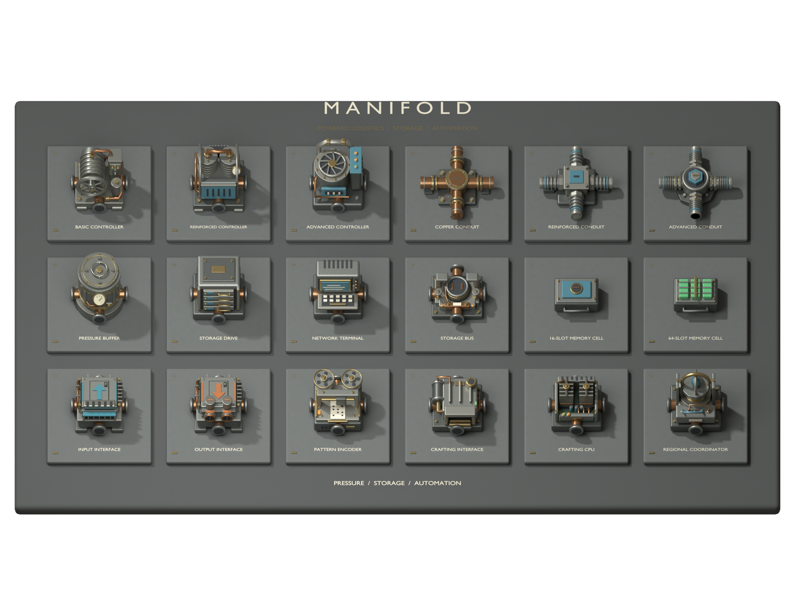
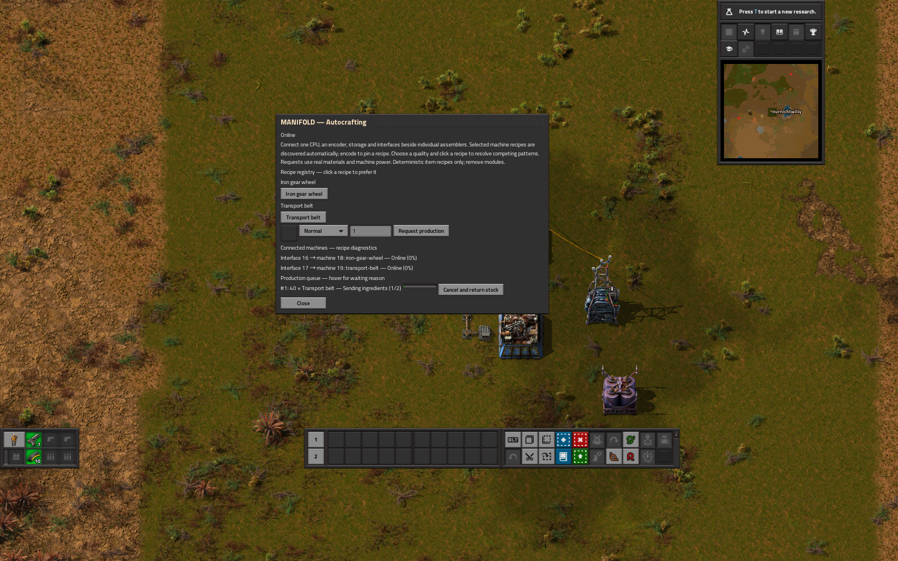

# Manifold



**From copper conduits to a connected factory.** Manifold adds powered item networks, portable storage and production requests fulfilled by real Factorio machines. Research improves existing networks; better controllers and conduits raise their limits. Belts, trains and inserters still have work to do.

**Public preview · Factorio 2.0 & 2.1 · Space Age optional · English UI**

[Download releases](https://github.com/NurNichtWilly/factorio-manifold-releases/releases) · [Report a bug](https://github.com/NurNichtWilly/factorio-manifold-releases/issues/new/choose) · [Player guide](docs/GUIDE.md) · [Known limitations](docs/KNOWN_LIMITATIONS.md)

## What you can build

- **Powered transport:** tile-adjacent networks with real item ownership, shared connection bandwidth, delivery latency, buffers and recoverable interrupted transfers.
- **Central storage:** portable 16- and 64-slot cells, four-bay drives, searchable terminals and physical chest storage buses.
- **Smart logistics:** item/quality filters, priorities, stock targets and circuit enable conditions.
- **Machine crafting:** automatic recipe discovery, explicit recipe preferences, dependency planning and physical material reservations. Your assembling machines do every craft.
- **Regional freight:** coordinate providers, requesters and depot trains. Inserters load and unload real wagons.
- **Vanilla endgame:** advanced hardware reaches a six-tick minimum local packet delay; default capacity is 160 items/s, or 280 with all bandwidth ranks.
- **Optional Space Age:** planetary research, freshness-preserving movement between native inventories and native rocket/platform material requests.
- **Original industrial artwork:** animated operating mechanisms across all thirteen machine families, with paired shadows and 55 direction/design views.



## Resource Compressor Extended

Pair Manifold with [Resource Compressor Extended](https://mods.factorio.com/mod/faccompress) to transport compact bundles, store them centrally and request compression through real machines. The mods share an industrial visual style and also work independently. [Compatibility and setup](docs/FACCOMPRESS.md).

## Install

| Your Factorio version | Manifold download | Optional compressor companion |
| --- | --- | --- |
| **2.0.77+ in the 2.0 series** | [0.11.5](https://github.com/NurNichtWilly/factorio-manifold-releases/releases/download/v0.11.5/manifold_0.11.5.zip) | [Resource Compressor 3.0.0](https://github.com/NurNichtWilly/factorio-faccompress-releases/releases/tag/v3.0.0) |
| **2.1.22+ in the 2.1 series** | [0.12.1](https://github.com/NurNichtWilly/factorio-manifold-releases/releases/download/v0.12.1/manifold_0.12.1.zip) | [Resource Compressor 3.1.0](https://github.com/NurNichtWilly/factorio-faccompress-releases/releases/tag/v3.1.0) |

1. Download the ZIP for your game version. GitHub's automatic **Source code** archives are not installable mods.
2. Put the ZIP, without extracting it, in your Factorio `mods` folder.
3. Enable **Manifold** in Mods and restart Factorio.
4. Start a game or load a backed-up save. Research **Basic Manifold networks** after Automation.

Mod folders: Windows `%APPDATA%\Factorio\mods`; macOS `~/Library/Application Support/factorio/mods`; Linux `~/.factorio/mods`.

Space Age and Quality are optional. Both game branches passed joint compressor production, transport and save/reload tests, with and without Space Age. This is an early public preview: multiplayer, long campaigns and arbitrary overhaul combinations have not been fully validated.

## Your first network

Build an uninterrupted line, placing each component on the next tile:

```text
Source chest
    ↓
Input interface
    ↓
Copper conduit
    ↓
Basic controller ← electricity from a nearby pole
    ↓
Copper conduit
    ↓
Output interface
    ↓
Destination chest
```

Supply the controller from an electric pole and put iron plates in the source chest. Use exactly one controller per connected network and one adjacent external inventory per interface. Default transport begins after two seconds and is capped at 20 items/s per source and shared connection.

Click a component or press **Ctrl+M** over it for diagnostics. Remove and reconnect a conduit to try interruption handling. Destroyed endpoints can leave recoverable items: use **Recover orphaned items** or `/manifold recover`.

Next, unlock central storage and connect a drive with a cell and a terminal. For crafting, connect a CPU, encoder and crafting interfaces beside empty assembling machines with their recipes selected. The [player guide](docs/GUIDE.md) walks through storage, filtering, train setup and crafting.

## Scope of this preview

The core logistics, storage and bounded crafting systems are implemented. The original five-stage design remains a longer-term target; the current game has three transport hardware tiers. Crafting supports deterministic recipes with a single item result and up to eight nonspoilable item ingredients, without modules or positive quality effects. Fluids, furnaces and probabilistic recycling/quality production are outside its current scope.

[Known limitations](docs/KNOWN_LIMITATIONS.md) describes practical bounds and unverified cases. [Progression](docs/PROGRESSION.md) lists actual unlocks and rates. The MIT license covers original mod code and artwork; Factorio is required and is not included.

## Feedback

Please include your Factorio version, Manifold version, enabled mods, steps to reproduce, expected/actual behavior and, when useful, a save, screenshot and `factorio-current.log`. Review logs and saves before posting personal information. Use the public repository's [issue tracker](https://github.com/NurNichtWilly/factorio-manifold-releases/issues).

This public repository contains released documentation, screenshots and release assets. Development sources, tests and editable Blender scenes are maintained separately. The installable ZIP includes the Lua code and assets required to run the mod.
